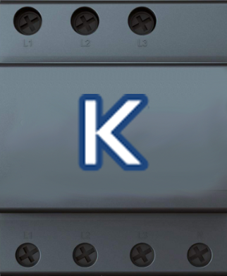

# ioBroker.kostal-ksem

ioBroker-Adapter für den **KOSTAL Smart Energy Meter (KSEM)**. Er liest die Messwerte des Zählers und den Energiefluss der Anlage in Echtzeit über die lokale WebSocket-Schnittstelle des KSEM und steuert eine angeschlossene **KOSTAL Wallbox** (Lademodus, Pause, Phasenumschaltung).

Der Adapter spricht nur mit dem KSEM im lokalen Netz – keine Cloud, kein Modbus nötig.

## Voraussetzungen

- KSEM im lokalen Netz, erreichbar per HTTP (getestet mit Firmware 2.7.2)
- Admin-Passwort der KSEM-Weboberfläche
- ioBroker mit Node.js ≥ 18
- Für die Wallbox-Funktionen: eine am KSEM eingebundene KOSTAL Wallbox

## Installation

Der Adapter ist nicht im ioBroker-Repository. Installation direkt aus GitHub:

```bash
iobroker url https://github.com/janpedder/iobroker.kostal-ksem
iobroker add kostal-ksem
```

Alternativ in der Admin-Oberfläche unter **Adapter → „Installieren aus eigener URL“** (Katzen-Symbol) mit derselben Adresse.

## Konfiguration

| Einstellung | Bedeutung |
|---|---|
| IP-Adresse oder Hostname | Adresse des KSEM, ohne `http://` und ohne `/` am Ende |
| Passwort | Admin-Passwort der KSEM-Weboberfläche (Benutzer `admin`) |
| Aktualisierungsintervall Messwerte | Wie oft Smart-Meter- und Energiefluss-Werte höchstens in ioBroker geschrieben werden (1–60 s). Der KSEM sendet deutlich häufiger; das Intervall drosselt nur die Schreibvorgänge. |
| Smart Meter – Datenpunkte | Welche Gruppen angelegt werden: Gesamtwerte, Energiezähler gesamt, Phasenwerte L1–L3, Energiezähler L1–L3 |
| Energiefluss aktivieren | Summenwerte der Anlage (PV, Netz, Haus, Batterie, Wallbox) |
| Wallbox aktivieren | Wallbox-Status und -Steuerung |
| Wallbox Abfrageintervall | Wie oft der Wallbox-Status abgefragt wird (Sekunden, mindestens 2) |

## Datenpunkte

### `info`

| Datenpunkt | Inhalt |
|---|---|
| `info.connection` | Verbindung zum KSEM steht |
| `info.serial`, `info.firmware`, `info.hostname`, `info.mac` | Geräteinformationen |

### `smartmeter` – Messwerte des Zählers

Die Namen folgen den OBIS-Kennzahlen des KSEM. `plus` = Bezug aus dem Netz, `minus` = Einspeisung.

| Datenpunkt | Einheit |
|---|---|
| `active_power_plus` / `active_power_minus` | W |
| `reactive_power_plus` / `reactive_power_minus` | var |
| `apparent_power_plus` / `apparent_power_minus` | VA |
| `power_factor` | – |
| `frequency` | Hz |
| `…_l1`, `…_l2`, `…_l3` (Leistungen je Phase), `current_l1…l3`, `voltage_l1…l3`, `power_factor_l1…l3` | W, var, VA, A, V |
| `…_kwh` (z. B. `active_power_plus_kwh`, `active_power_minus_l1_kwh`) | kWh, Zählerstände |

### `energyflow` – Energiefluss der Anlage

| Datenpunkt | Inhalt | Einheit |
|---|---|---|
| `gridPowerTotal` | Netzleistung (+ Bezug / − Einspeisung) | W |
| `pvPowerTotal` / `pvPowerACSum` | PV-Leistung DC / AC | W |
| `housePowerTotal` | Hausverbrauch | W |
| `homeConsumptionPV` / `homeConsumptionGrid` / `homeConsumptionBattery` | Hausverbrauch nach Quelle | W |
| `batteryPowerTotal` / `batteryPowerACSum` | Batterieleistung | W |
| `systemStateOfCharge` | Ladezustand der Batterie | % |
| `batteryChargeLimit` / `batteryDischargeLimit` | Lade-/Entladelimit der Batterie | W |
| `inverterPowerTotal` | Wechselrichterleistung | W |
| `inverterCurtailment` | Abregelung des Wechselrichters aktiv | – |
| `wallboxPowerTotal` | Wallbox-Leistung | W |
| `wallboxConsumptionPV` / `wallboxConsumptionGrid` / `wallboxConsumptionBattery` | Wallbox-Verbrauch nach Quelle | W |
| `auxiliaryPowerTotal` | Hilfsverbrauch | W |
| `smartGridLimit` | Smart-Grid-Limit | W |

### `wallbox.<uuid>` – je erkannter Wallbox

Lesend:

| Datenpunkt | Inhalt |
|---|---|
| `connected` | Fahrzeug angeschlossen |
| `charging` | Fahrzeug lädt (mindestens eine Phase aktiv) |
| `phases_l1`, `phases_l2`, `phases_l3` | Phase aktiv |
| `min_current` / `max_current` | Minimal-/Maximalstrom (A) |
| `charging_power_w` | aktuelle Ladeleistung (W, alle 30 s) |
| `available_power_w` | vom KSEM freigegebene Leistung (W, aus den Strom-Sollwerten × 230 V, alle 30 s) |

Schreibend (Wert mit `ack=false` setzen):

| Datenpunkt | Werte | Wirkung |
|---|---|---|
| `chargemode` | `pv`, `hybrid`, `grid`, `lock` | Lademodus setzen |
| `pause` | `true` / `false` | Laden pausieren / fortsetzen |
| `phase_usage` | `0` = 3-phasig, `1` = 1-phasig | Phasenumschaltung |

## Hinweise zur Wallbox-Steuerung

- **Der Lademodus ist nicht rücklesbar.** Die KSEM-API bietet für `chargemode` nur Schreiben an. Der Datenpunkt zeigt deshalb den zuletzt *erfolgreich gesetzten* Modus, nicht zwingend den aktuellen Zustand am Gerät (z. B. nach einer Änderung in der KSEM-Weboberfläche).
- **Lademodus und Phasenumschaltung gelten für den KSEM insgesamt**, nicht pro Wallbox. Bei mehreren Wallboxen wirkt ein Schreiben auf `chargemode` oder `phase_usage` einer Wallbox auf alle. `pause` wirkt dagegen nur auf die jeweilige Wallbox.
- **Ein Wechsel auf `pv` beendet eine laufende Ladung nicht.** Wer eine Ladung sicher stoppen will, setzt `pause` auf `true` (oder den Modus `lock`).

## Funktionsweise

- Anmeldung an der KSEM-Weboberfläche (`/api/web-login/token`); das Token wird automatisch erneuert, bevor es abläuft.
- Messwerte und Energiefluss kommen per WebSocket (Protobuf) vom KSEM: `…/values/smart-meter` und `…/values/kostal-energyflow/sumvalues`. Schlägt die Verbindung fehl, versucht der Adapter es nach 30 Sekunden erneut.
- Wallbox-Status und -Steuerung laufen über die REST-Schnittstelle `/api/e-mobility/…`.
- Werte werden nur geschrieben, wenn sie sich ändern (und höchstens im eingestellten Intervall).

## Lizenz

MIT © Jan Pedder
